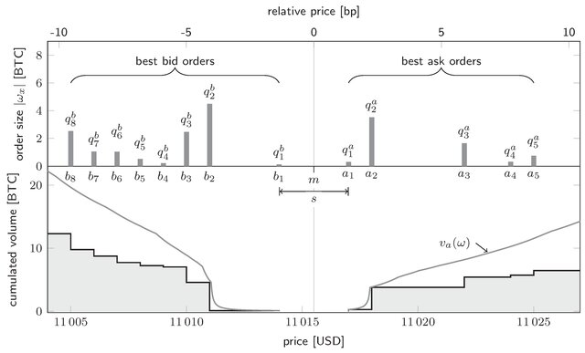
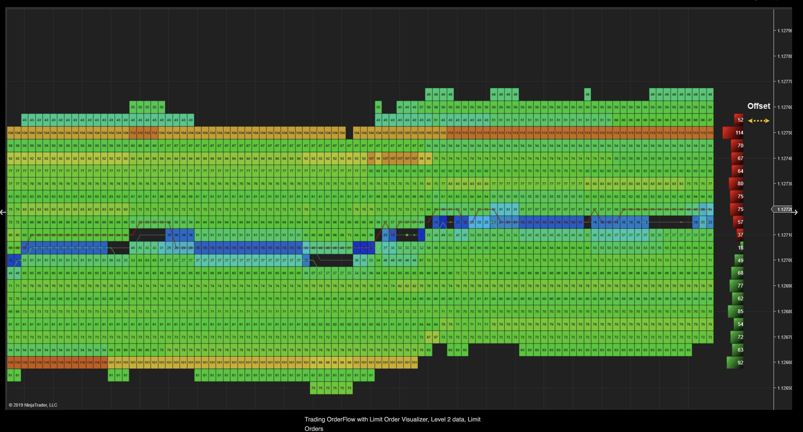
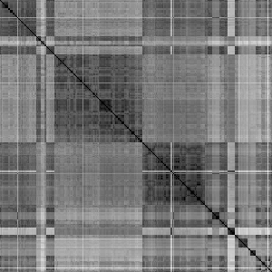

---
Temporal Adversarial Reconstruction \
From High Frequency Latent Spaces
---

*State* representation of a Financial Market
===

From a Microstructure perspective, the Limit Order Book (LOB) is the fundamental Data structure
to represent the state of the market at any give point in time.



<!-- end_slide -->

*Dynamics* of a LOB
===

The fundamental data structure of Order-Driven markets is the *Limit Order Book*



<!-- end_slide -->


Dual-Subspace Relative Vectorization
===

Each snapshot $S(t)$ is mapped to two vectors, forming a **dual-subspace
representation** that separates price-grid geometry from volume profile.

Each level's price is expressed as its distance from the mid-price in
**basis points** (1 bps = 0.01%):

```latex +render
$$
\underbrace{\text{Parquet}}_{\text{delta stream}}
\;\xrightarrow{\text{ingest}}\;
\underbrace{\{(t_i, \Delta_i)\}}_{\text{batches}}
\;\xrightarrow{\text{reconstruct}}\;
\underbrace{\{S(1), \dots, S(N)\}}_{\text{LOB snapshots}}
\;\xrightarrow{\text{vectorize}}\;
\underbrace{\{(\mathbf{p}(t), \mathbf{v}(t))\}}_{\mathbb{R}^{2k} \times \mathbb{R}^{2k}}
$$
 
$$
\xrightarrow{\text{distance}}\;
\underbrace{D \in \mathbb{R}^{N \times N}}_{\alpha\text{-combined}}
\;\xrightarrow{\text{render}}\;
\underbrace{\text{PNG}}_{\text{N} \times \text{N grayscale}}
$$
```

<!-- end_slide -->

Title
===

## 7. Stage 5 — The Recurrence Plot Image
 
The combined distance matrix $D \in \mathbb{R}^{N \times N}$ is mapped to
a grayscale image.
 
### 7.1 Continuous RP (Grayscale)
 
Normalize $D$ to $[0, 1]$ and map to 8-bit pixel intensity:
 
```latex +render
$$
\text{pixel}(i, j) = \left\lfloor \frac{D(i,j)}{\max D} \times 255 + 0.5 \right\rfloor
$$
```
 
| Pixel value | Meaning                                  |
|-------------|------------------------------------------|
| 0 (black)   | $D = 0$ — identical book states          |
| 255 (white) | $D = \max D$ — maximally dissimilar pair |
 
The main diagonal is always black (self-recurrence). The image is
symmetric about this diagonal.
 
### 7.2 Binary RP (Black and White)
 
A threshold $\varepsilon$ is applied to the normalized distance matrix to
produce a binary recurrence matrix:
 
```latex +render
$$
R(i,j) =
\begin{cases}
1 & \text{if } \hat{D}(i,j) < \varepsilon \\
0 & \text{otherwise}
\end{cases}
$$
```
 
This is rendered as a black-and-white image: black pixels are recurrence
points ($R = 1$), white pixels are non-recurrent ($R = 0$). The binary RP
is the classical form used in Recurrence Quantification Analysis (RQA).
 
---

<!-- end_slide -->

Recurrence Plot
===



<!-- end_slide -->

The RP Inverse
===

From Recurrence Plot (Synthetically Generated) to Limit Order Book. 

A Recurrence Plot is defined by the matrix.

# Formulas

```latex +render
\[ \sum_{n=1}^{\infty} 2^{-n} = 1 \]
```

<!-- end_slide -->

Challenges of LOB modeling with RPs
===

- Non-Stationarity: 

LOB dynamics change during "market regime shifts", making distance estimation difficult.

- Discrete vs. Continuous: 

Prices move in ticks. Standard reconstruction models assume a continuous phase space, which can lead to "ghost" price levels that don't exist on the exchange's grid.

- Uniqueness: 

Multiple LOB configurations can produce the same RP (e.g., a price move with high volume vs. a price move with low volume might result in similar Euclidean distances in the state vector).

<!-- end_slide -->

FID
===

image quality using the Fréchet Inception Distance (FID) score


```latex +render
D_M(x) = \sqrt{(x - \mu)^T \Sigma^{-1} (x - \mu)}
```
Where:
```latex +render
x = [x_1, x_2, \dots, x_n]^T
```


<!-- end_slide -->
